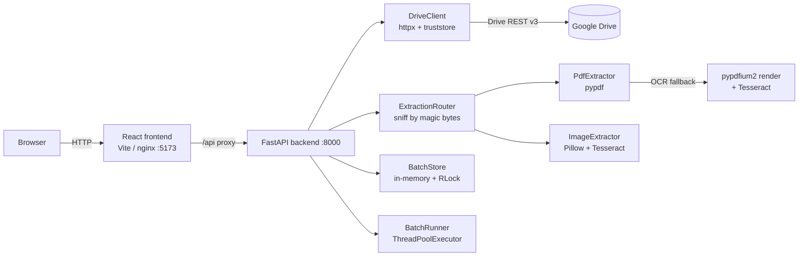

# Drive-to-Text POC (TA-2026-01)

Extract selectable text and OCR text from PDFs and images stored in a shared
Google Drive folder. Assessment project for DI Xpertia TA-2026-01.

---

## Architecture



**No database, no queue.** Batches are stored in memory with a configurable TTL
(`BATCH_TTL_MINUTES`, default 60 min). A single `ThreadPoolExecutor` with
`BATCH_WORKERS` threads (default 2) processes files concurrently inside one
process.

---

## Why this stack

| Choice | Reason |
|--------|--------|
| **httpx** instead of the Google Drive Python client library | Lighter, easier to mock in tests, avoids the `google-auth` dependency tree |
| **pypdfium2** instead of Poppler / pdf2image / Ghostscript | Pre-built wheel, permissive licence (BSD-3-Clause / Apache-2.0), no GPL/AGPL dependency |
| **pypdf** for text extraction | Pure Python, BSD-3-Clause, no native dependencies |
| **Tesseract** called via pytesseract | Apache-2.0, strong multilingual support, invoked as external process (not linked) |
| **In-memory batches** | Avoids Redis/Celery for a POC; `BATCH_WORKERS=1` is enough for demos |
| **truststore** | Makes httpx use the OS certificate store so the app works on corporate networks with TLS-intercepting proxies |

---

## Prerequisites

| Tool | Minimum version | Notes |
|------|----------------|-------|
| Python | 3.11 | 3.12 used in CI and Docker |
| Node.js | 20.19.0 or ≥ 22.12.0 | Vite 7 engine requirement |
| Tesseract | 5 | With `fra`, `eng`, and `ara` language packs |
| Google Drive API key | — | See section below |

### Install Tesseract

**Windows** — download the [UB Mannheim installer](https://github.com/UB-Mannheim/tesseract/wiki).
During installation tick **Additional language data → French** and **Arabic**.
If Tesseract is not on `PATH`, set `TESSERACT_CMD` in `backend/.env`.

**Ubuntu/Debian**
```bash
sudo apt-get install tesseract-ocr tesseract-ocr-eng tesseract-ocr-fra tesseract-ocr-ara
```

**macOS**
```bash
brew install tesseract tesseract-lang
```

---

## Google Drive API key

1. Go to [Google Cloud Console](https://console.cloud.google.com/) and create a
   project (or select an existing one).
2. Enable the **Google Drive API** (APIs & Services → Library → search "Drive").
3. Create an **API key** (APIs & Services → Credentials → Create Credentials →
   API key).
4. Restrict the key to **Google Drive API** only (Credentials → edit the key →
   API restrictions).
5. Copy the key into `backend/.env`:
   ```
   GOOGLE_API_KEY=your_key_here
   ```
6. **Never commit `.env`** — it is listed in `.gitignore`.

The key is sent exclusively in the `X-Goog-Api-Key` request header; it never
appears in a URL query string.

---

## Setup

### Backend

```bash
cd backend
python -m venv .venv

# Windows
.venv\Scripts\activate
# Linux / macOS
source .venv/bin/activate

pip install -r requirements.txt
cp .env.example .env
# Edit .env — set GOOGLE_API_KEY and, on Windows, TESSERACT_CMD
```

### Frontend

```bash
cd frontend
npm install
```

---

## Run (development)

```bash
# Terminal 1 — backend (auto-reload)
cd backend
uvicorn app.main:app --reload --port 8000

# Terminal 2 — frontend (HMR dev server)
cd frontend
npm run dev
```

Open <http://localhost:5173>.  
The Vite dev server proxies `/api/*` to `http://127.0.0.1:8000`.

---

## Docker

```bash
# Build and start both services
docker compose up --build
```

- **Frontend** → <http://localhost:8080>
- **Backend** → <http://localhost:8000/api/health>

The compose file loads `backend/.env` via `env_file` and overrides
`TESSERACT_CMD=""` and `TESSDATA_PREFIX=""` so the Windows paths in the local
`.env` are ignored inside the container (Tesseract is on `PATH` in the image).

> **Disk space:** the backend image downloads Tesseract and all Python wheels.
> Ensure at least ~1 GB free on the Docker data drive before building.

---

## Tests

```bash
# Backend (from backend/)
pytest                # all tests
ruff check .          # linter

# Frontend (from frontend/)
npm run lint          # ESLint
npm run build         # TypeScript + Vite production build
```

---

## API

All error responses use the envelope:

```json
{ "error": { "code": "ERROR_CODE", "message": "Human-readable message." } }
```

### Endpoints

| Method | Path | Status | Description |
|--------|------|--------|-------------|
| `GET` | `/api/health` | 200 | Liveness check + Tesseract status |
| `POST` | `/api/drive/files` | 200 | List PDFs and images in a Drive folder |
| `POST` | `/api/batches` | 202 | Create and start an extraction batch |
| `GET` | `/api/batches/{id}` | 200 | Poll batch state |
| `GET` | `/api/batches/{id}/export` | 200 | Download results as JSON attachment |

### Stable error codes

| Code | HTTP | Meaning |
|------|------|---------|
| `INVALID_FOLDER_URL` | 422 | URL is not a valid Drive folder link |
| `INVALID_FILE_ID` | 422 | File ID fails the Drive ID format check |
| `INVALID_LANGUAGE` | 422 | Language not in the allowed set |
| `VALIDATION_ERROR` | 422 | Request body schema error |
| `TOO_MANY_FILES` | 422 | Batch exceeds `MAX_FILES_PER_BATCH` |
| `FOLDER_NOT_FOUND_OR_PRIVATE` | 404 | Folder missing or not publicly shared |
| `FILE_NOT_FOUND` | 404 | File missing or trashed |
| `BATCH_NOT_FOUND` | 404 | Batch ID unknown or expired |
| `FILE_TOO_LARGE` | 413 | File exceeds `MAX_FILE_SIZE_MB` |
| `CORRUPTED_FILE` | 422 | PDF or image could not be decoded |
| `PDF_ENCRYPTED` | 422 | PDF is password-protected |
| `UNSUPPORTED_TYPE` | 415 | Magic bytes not PDF, PNG, or JPEG |
| `OCR_TIMEOUT` | 422 | Tesseract exceeded `OCR_PAGE_TIMEOUT_S` |
| `OCR_ENGINE_UNAVAILABLE` | 503 | Tesseract not found on the host |
| `DRIVE_NOT_CONFIGURED` | 500 | `GOOGLE_API_KEY` missing or invalid |
| `DRIVE_QUOTA` | 429 | Drive API rate or quota limit hit |
| `DRIVE_UNAVAILABLE` | 502 | Drive API returned a 5xx error |
| `INTERNAL_ERROR` | 500 | Unhandled exception (details not leaked) |

---

## Processing strategy

1. **Content-type detection** — the raw file bytes are sniffed using magic bytes
   (`%PDF-` within the first 1 024 bytes for PDF; `\x89PNG` for PNG;
   `\xff\xd8\xff` for JPEG). The Drive MIME type is ignored; a file whose Drive
   metadata says `image/jpeg` but whose bytes start with `%PDF-` is routed to
   the PDF extractor.

2. **PDF: native text first** — pypdf extracts selectable text from each page.
   A page whose alphanumeric character count is below `MIN_PAGE_CHARS` (default
   25) is treated as image-only and sent to the OCR fallback.

3. **OCR fallback** — pypdfium2 renders the page at `OCR_RENDER_DPI` (default
   200 DPI) and Tesseract reads the bitmap. Rendering is protected by a
   module-level threading lock (pypdfium2 is not thread-safe).

4. **Extraction method** reported per file:
   - `pdf_text` — all pages had sufficient native text, OCR never called.
   - `ocr` — every page went through OCR (including image files).
   - `pdf_text+ocr` — some pages were native, some were OCR'd.

5. **Warnings** appended to each result:
   - `TRUNCATED` — file exceeded `MAX_PDF_PAGES` or `FILE_TIME_BUDGET_S`.
   - `NO_TEXT_FOUND` — extraction produced no alphanumeric characters.
   - `PAGE_TOO_LARGE` — rendered pixel count exceeded `MAX_IMAGE_PIXELS`; that
     page was skipped.

---

## Configuration

All settings are read from environment variables (or `backend/.env`).
Empty-string values for `GOOGLE_API_KEY`, `TESSERACT_CMD`, and `TESSDATA_PREFIX`
are treated as `None` (useful for Docker Compose overrides).

| Variable | Default | Description |
|----------|---------|-------------|
| `GOOGLE_API_KEY` | _(none)_ | Drive API key — required for Drive requests |
| `CORS_ORIGINS` | `http://localhost:5173` | Comma-separated allowed origins |
| `TESSERACT_CMD` | _(none)_ | Full path to the `tesseract` binary; leave blank to use `PATH` |
| `TESSDATA_PREFIX` | _(none)_ | Path to `tessdata` directory; leave blank for Tesseract default |
| `DEFAULT_OCR_LANGUAGE` | `fra+eng` | Tesseract language code(s) used when the request omits a language |
| `MAX_FILE_SIZE_MB` | `25` | Reject files larger than this |
| `MAX_FILES_PER_BATCH` | `50` | Maximum files per batch request |
| `MAX_LISTED_FILES` | `500` | Maximum files returned when listing a folder |
| `MAX_PDF_PAGES` | `30` | Stop processing after this many PDF pages |
| `MAX_IMAGE_PIXELS` | `50000000` | Reject images whose width × height exceeds this |
| `FILE_TIME_BUDGET_S` | `120` | Wall-clock budget per file (triggers TRUNCATED) |
| `OCR_PAGE_TIMEOUT_S` | `60` | Tesseract timeout per page |
| `MIN_PAGE_CHARS` | `25` | Alphanumeric threshold below which OCR fallback is used |
| `OCR_RENDER_DPI` | `200` | DPI for pypdfium2 rasterisation before OCR |
| `BATCH_WORKERS` | `2` | Concurrent threads in the batch executor |
| `BATCH_TTL_MINUTES` | `60` | Finished batches are purged after this many minutes |
| `LOG_LEVEL` | `INFO` | Python logging level |

---

## Sample output

`samples/sample_output.json` was produced by running the application against
the public test folder:

<https://drive.google.com/drive/folders/1-Kd3c7lea1QuN7xR4ae_hrXMK6lS-SOh>

The folder contains six files: two native PDFs, one scanned PDF (image-only),
one PNG invoice, one JPEG meeting note, one intentionally corrupted PDF, and one
password-protected PDF. The export was downloaded via
`GET /api/batches/{id}/export`.

---

## Security notes

- The API key is sent only in the `X-Goog-Api-Key` request header; it is never
  logged, never placed in a URL, and never returned to the browser.
- No URL provided by the user is fetched directly by the server; only validated
  Drive file IDs are used to call the Drive API.
- File type is determined by magic bytes, not by the filename extension or Drive
  MIME type, to prevent type-confusion attacks.
- File size, page count, pixel count, and processing time are all bounded by
  configurable limits.
- **truststore** makes httpx use the OS certificate store, so the application
  works correctly on corporate networks that perform TLS inspection without
  disabling certificate verification.
- Stack traces and internal error details are never returned to the client;
  unhandled exceptions produce only `INTERNAL_ERROR` with the message
  "Unexpected server error."

---

## Known limits

- **In-memory batches** — batch state is lost when the server restarts.
  `BATCH_TTL_MINUTES` controls how long completed batches are kept.
- **Single worker** — the `uvicorn` command uses `--workers 1` because the batch
  store is in memory. Do not add workers without replacing the store.
- **Non-recursive** — only files directly inside the given folder are listed;
  sub-folders are not traversed.
- **Shortcuts and resource-key links** — Google Drive shortcuts and URLs
  containing `resourcekey=` are not supported.
- **Arabic quality** — pypdf does not support right-to-left text reflow;
  Tesseract Arabic accuracy depends heavily on font quality and scan resolution.
- **Garbage text layers** — a scanned PDF with an embedded (possibly incorrect)
  OCR text layer will pass the `MIN_PAGE_CHARS` threshold and return the
  embedded text instead of re-running OCR.
- **Drive quotas** — the API key is subject to Google's default quota (10 000
  requests/day for the Drive API). Heavy use may trigger `DRIVE_QUOTA` errors.

---

## Next steps

- Replace the in-memory batch store with a persistent queue (e.g. Redis + Celery
  or a lightweight SQLite store) so batches survive restarts.
- Push real-time progress via Server-Sent Events instead of polling.
- Add recursive folder traversal.
- Use Tesseract OSD (orientation and script detection) to auto-rotate pages
  before OCR.
- Apply a document-level pdfium fallback: if pypdf returns zero characters for
  the entire document, skip the per-page threshold and render everything.

---

## Licence

Application code: [LICENSE](LICENSE) (MIT).  
Third-party dependency licences: [LICENSES.md](LICENSES.md).
